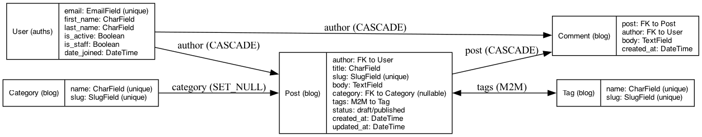

# Blog Api

Django REST API для блога с JWT-аутентификацией.

## Стек

- Python 3.12, Django 5.0.9
- Django REST Framework
- djangorestframework-simplejwt (JWT auth)
- SQLite (local) / PosrgreSQL (prod)
- python-decouple (env variables)
- ruff (linter)

## Структура проекта

    blog-api/
    apps/
        auths/      - кастомная модель User, регистрация, JWT
        blog/       - Category, Tag, Post, Comment
    settings/
        conf.py     - чтение переменных окружения
        base.py     - общие настройки
        env/
            local.py
            prod.py
        urls.py
        wsgi.py
        asgi.py
    docs/
        erd.png     - ER-диаграмма
    requirements/
        base.txt
        dev.txt
        prod.txt
    manage.py

## Установка и запуск

    git clone <repo-url>
    cd blog-api
    python3 -m venv .venv
    source .venv/bin/activate
    pip install -r requirements/dev.txt
    cp settings/.env.example settings/.env
    python manage.py migrate
    python manage.py createsuperuser
    python manage.py runserver

## ER-диаграмма

## Эндпоинты API

### Auth (/api/v1/auth/)

| Метод | Эндпоинт | Описание |
|---|---|---|
| POST | /register/ | Регистрация пользователя |
| POST | /login/ | Получение JWT токенов |
| POST | /refresh/ | Обновление access токена |

### Blog (/api/v1/blog/)

| Метод | Эндпоинт | Описание |
|---|---|---|
| GET/POST | /categories/ | Список / создание категорий |
| GET/POST | /tags/ | Список / создание тегов |
| GET/POST | /posts/ | Список / создание постов |
| GET/PUT/DELETE | /posts/{id}/ | Детали / изменение / удаление поста |
| GET/POST | /comments/ | Список / создание комментариев |

## Модели
- User - кастомная модель пользователя (email вместо username)
- Category - категория поста
- Tag - тег поста
- Post - пост (автор, категория, теги, статус draft/published)
- Comment - комментарий к посту

## Автор

Aidana Shynbulatova, KBTU

## Заполнение базы (seed)

Команда заполняет все модели фейковыми данными (Faker, dev-зависимость):

    python manage.py seed [--users N] [--posts N] [--comments N] [--clear]

| Аргумент     | По умолчанию | Описание                                   |
|--------------|--------------|--------------------------------------------|
| `--users`    | 20           | Сколько пользователей создать              |
| `--posts`    | 100          | Сколько постов создать                     |
| `--comments` | 500          | Сколько комментариев создать               |
| `--clear`    | выкл.        | Удалить старые данные (суперюзеры остаются) |

Пример: `python manage.py seed --clear --users 50 --posts 300 --comments 1500`

У всех сид-пользователей пароль `seedpass123`.

## Админка (Django Unfold)

Запуск на пустой базе:

    python manage.py migrate
    python manage.py seed
    python manage.py createsuperuser
    python manage.py runserver

## Использование AI

Claude использовался для объяснения документации Django и Unfold и проверки кода. Весь код проверен и запущен мной.
